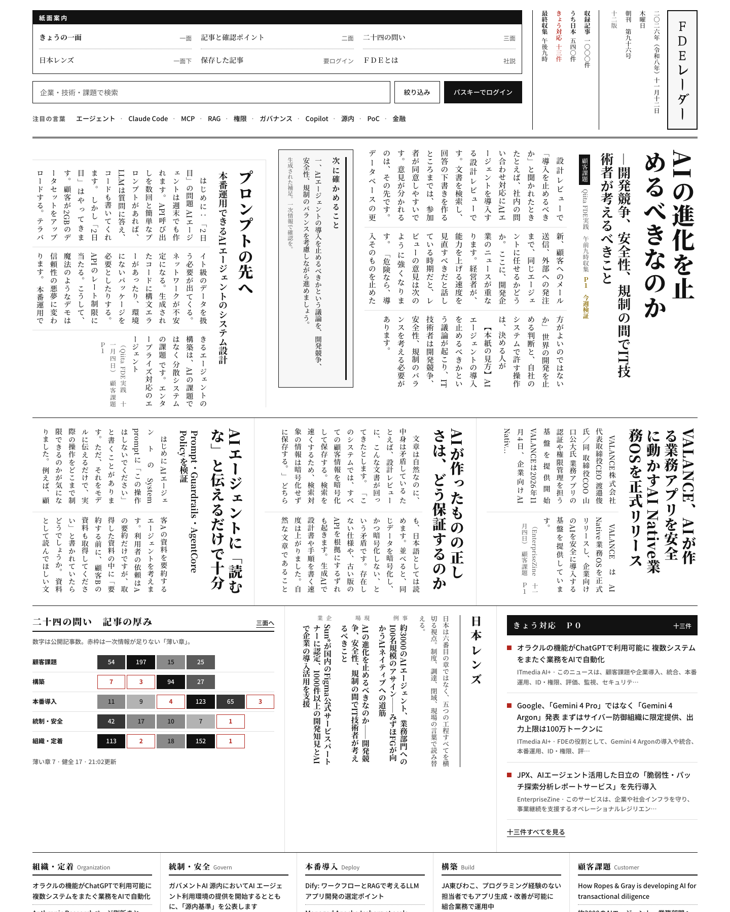
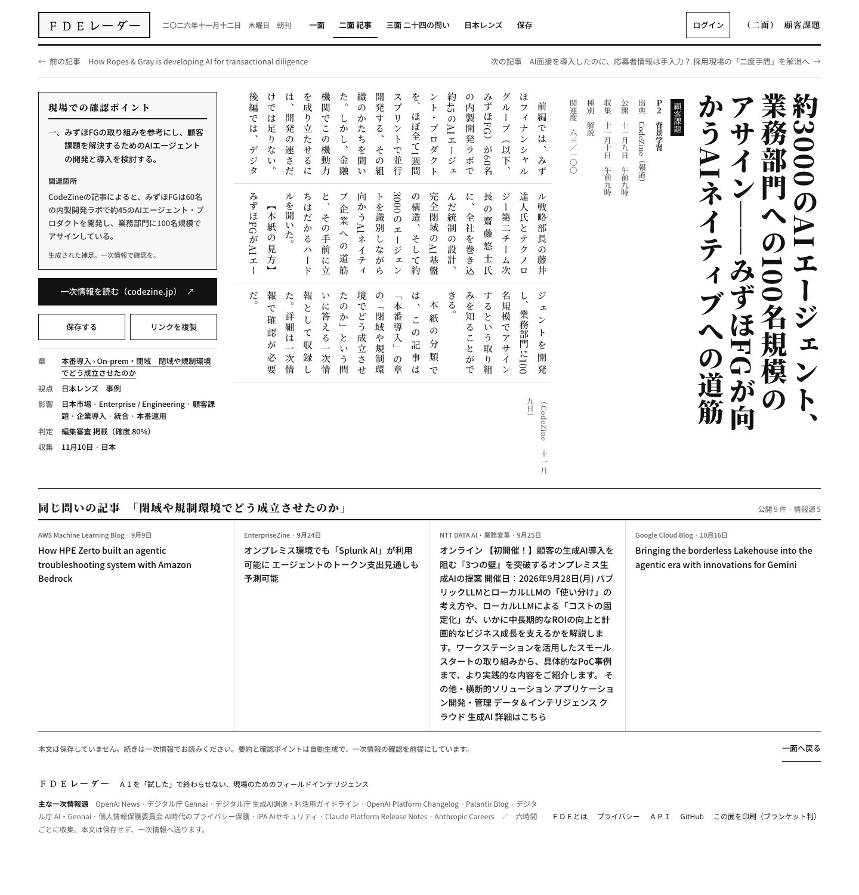
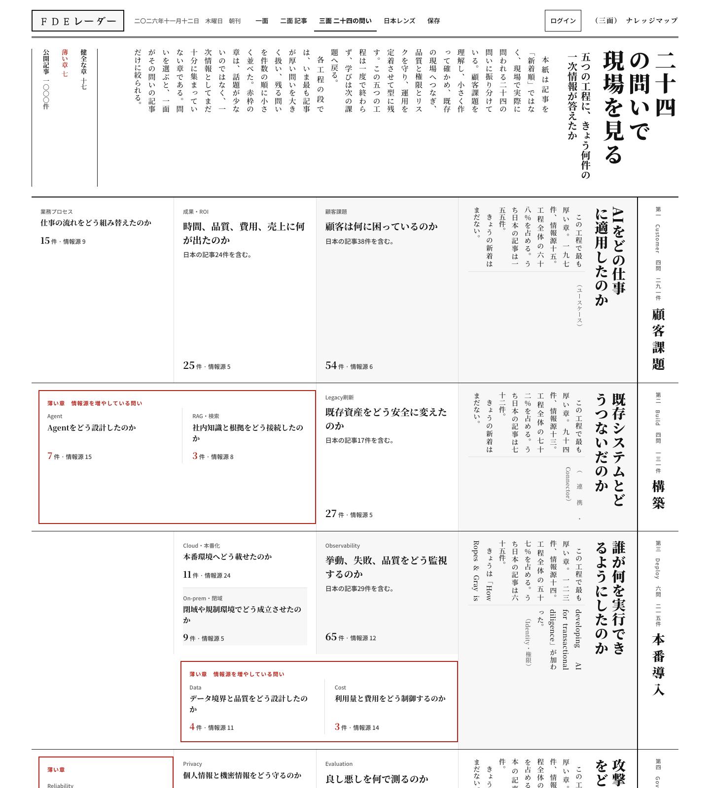
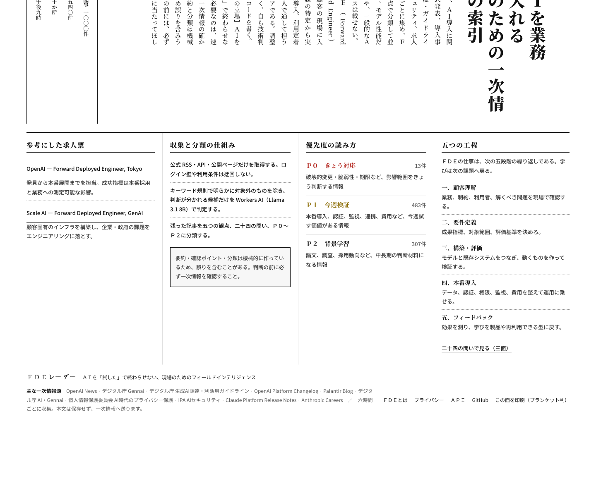
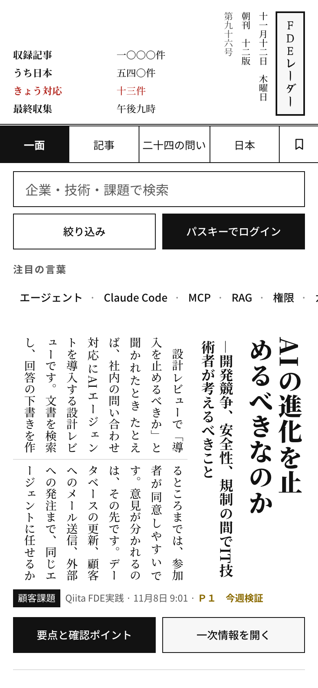

# ＦＤＥレーダー（FDE Radar）

> AI を「試した」で終わらせず、顧客の現場で使える成果へつなげるための、日本語フィールドインテリジェンス。

[公開サイト](https://fde.kejincai.dev) · [ドキュメント](#ドキュメント) · [Issue](https://github.com/kekincai/fde/issues)



## これは何か

FDE Radar は一般的な AI ニュース集約サイトではありません。公式発表、導入事例、実装知見、制度、安全性、組織変革、採用情報を6時間ごとに集め、AI 導入の実務ループ（顧客課題 → 構築 → 本番導入 → 統制・安全 → 組織定着）と24の問いに整理して、新聞の紙面として並べます。

読み手はエンジニアだけではありません。AI を導入する企業の担当者や意思決定者、FDE（Forward Deployed Engineer）という役割を知りたい人が、一次情報を起点に「何が変わったか」「なぜ重要か」「次に何を確かめるか」をつかむためのサイトです。

## 画面

| 二面：1本の記事と確認ポイント | 三面：二十四の問い |
|---|---|
|  |  |

| 社説：ＦＤＥとは | スマートフォン |
|---|---|
|  |  |

各面の役割と読み方は [docs/overview.md](docs/overview.md) にまとめています。

## 主な機能

- 6時間ごとの自動収集。情報源ごとに独立して動くため、1つが壊れても他は止まらない
- AI という語があるだけでは載せない。ルールと Workers AI の二段階で、現場との接点がある記事だけを公開
- 24の問いで記事の厚みを可視化し、一次情報が足りない「薄い章」を朱で示す
- P0（きょう対応）/ P1（今週検証）/ P2（背景学習）の判断レベル
- 日本語の全文検索、種類・章・地域・優先度・テーマでの絞り込み
- メールアドレスもパスワードも使わないパスキーでのログインと、記事の保存
- 管理者向けの利用状況・情報源の品質・収集状態のダッシュボード
- IP アドレス、検索語、生体情報を保存しない最小限の利用分析

## すぐに試す

```bash
npm install
npm run dev
```

`http://localhost:4321` で開きます。画面の開発だけなら環境変数は不要で、記事データは本番の API から読みます。Worker とデータベースまで手元で動かす方法は [docs/development.md](docs/development.md) を参照してください。

## ドキュメント

| 文書 | 内容 | 主な読み手 |
|---|---|---|
| [overview.md](docs/overview.md) | 5つの工程と24の問い、優先度、各面の読み方、キーボード操作 | 利用者・全員 |
| [ingestion-architecture.md](docs/ingestion-architecture.md) | 何を集め、何を載せないか。Workers AI による審査の仕組み | 編集方針を知りたい人 |
| [architecture.md](docs/architecture.md) | システム構成、データ構造、リポジトリ構成 | 開発者 |
| [design.md](docs/design.md) | 新聞紙面としての画面設計、書体、レスポンシブ、アイコン | 画面を変える人 |
| [development.md](docs/development.md) | ローカル開発、テスト、Git の運用ルール | 開発者 |
| [deployment.md](docs/deployment.md) | Cloudflare の構築、デプロイと migration の順序 | 本番を出す人 |
| [operations.md](docs/operations.md) | 収集の運用、日常点検、メール通知、障害対応、既知の制約 | 運用者 |
| [api.md](docs/api.md) | 公開 API と管理 API の一覧 | API を使う人 |
| [auth-and-privacy.md](docs/auth-and-privacy.md) | パスキー認証、保存するデータ、著作権と安全境界 | 全員 |

過去の記録：[2026-11-10 の監査](docs/audit-2026-11-10.md)、[紙面デザインの指示](design/newspaper-redesign-prompt.md)、[ブランドマーク](design/brand/README.md)。

## 技術構成

Astro + React の静的な画面と、Cloudflare Workers 上の Hono API。データは D1（全文検索は FTS5）、収集は Queues と Cron、意味判定は Workers AI、取得スナップショットは Hyperdrive 経由の PostgreSQL。詳しくは [docs/architecture.md](docs/architecture.md)。

## License

[MIT License](LICENSE)。外部の情報源の記事、ロゴ、商標、コンテンツは各権利者の利用条件に従います。
