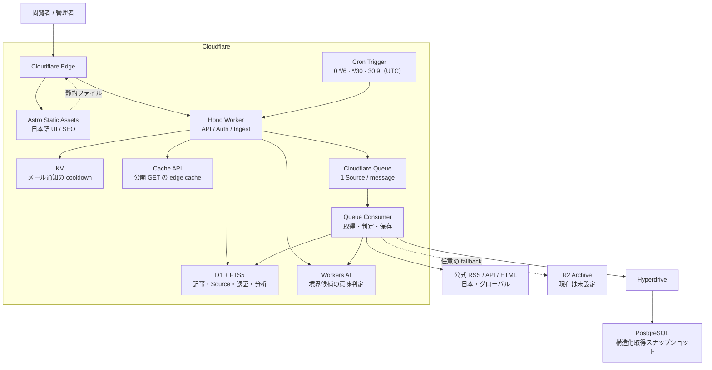
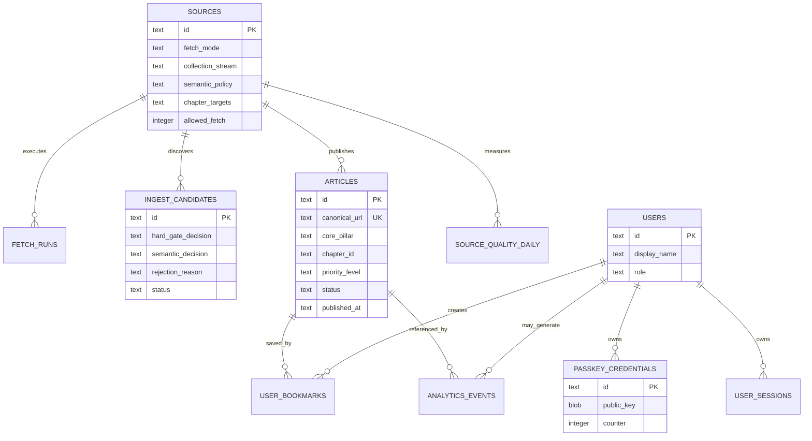

# システム構成

FDE Radar はすべて Cloudflare 上で動きます。画面は静的ファイル、API と収集は1つの Worker が担当します。

## 全体図



## コンポーネントの責任

| コンポーネント | 責任 | 保存するもの |
|---|---|---|
| Astro + React | 公開画面、検索・絞り込み、パスキー UI、管理画面 | ビルド済み静的アセット |
| Hono Worker | API、認証、ランキング、収集制御、Queue consumer | 永続データを直接保持しない |
| D1 | 公開記事、Source、判定履歴、ユーザー、保存、分析、リクエスト制限 | サービスの正本メタデータ |
| FTS5 | 日本語検索用インデックス | タイトル、要約、タグ、検索トークン |
| Workers AI | ルールだけでは判定できない候補の意味判定 | 結果は D1 に監査情報として保存 |
| Queues | Source ごとの非同期実行と再試行 | 一時的な ingest message |
| KV | 日報の送信済み印と、異常メールの Source ごとの cooldown | TTL 付きデータ |
| Cache API | `/api/articles`・`/api/articles/:id`・`/api/overview`・`/api/coverage` の edge cache（`s-maxage`） | 公開レスポンスの一時コピー |
| Hyperdrive + PostgreSQL | 許可された構造化取得スナップショット | `fde.source_archives` |
| R2 | PostgreSQL を使わない構成の任意 fallback | JSON スナップショット |

R2 は現在の本番構成では必須ではありません。Hyperdrive と PostgreSQL を優先し、`ARCHIVE` binding が存在する場合だけ R2 を fallback として使います。

収集と判定の流れは [ingestion-architecture.md](ingestion-architecture.md)、パスキー認証の流れは [auth-and-privacy.md](auth-and-privacy.md) を参照してください。

## データ構造



| テーブル | 用途 |
|---|---|
| `sources` | 取得面、優先度、失敗状態、ETag、章の供給責任 |
| `fetch_runs` | Source ごとの成功・失敗、発見数、backfill 情報 |
| `ingest_candidates` | Hard Gate と Workers AI の判定監査 |
| `articles` | 公開・抑制・アーカイブされた記事メタデータ |
| `articles_fts` | FTS5 検索インデックス |
| `source_quality_daily` | 発見、除外、公開、重複、AI エラーの日次集計 |
| `users` / `passkey_credentials` / `user_sessions` | パスキー認証と権限 |
| `user_bookmarks` | 保存した記事 |
| `analytics_events` | 最小限の利用状況分析 |
| `request_rate_limits` | 認証と匿名分析 API の原子的なリクエスト制限 |

### 記事の状態

| `status` | 意味 |
|---|---|
| `published` | 公開 API と画面に表示。ただし `fde_score >= 40` のものだけ（一覧、単体、件数、章の集計、日報、保存一覧で同じ条件） |
| `pending` | 再判定待ち |
| `rejected` | 収録条件を満たさない |
| `suppressed` | 監査用に保持するが公開しない |
| `archived` | 公開ベースライン以前など、履歴として保持 |

`suppressed` と `archived` は再取得で内容が変わっても `published` に戻りません。戻す場合は migration で明示的に更新します。

## リポジトリ構成

```text
.
├── src/
│   ├── components/
│   │   ├── RadarApp.tsx     # 公開画面の状態と画面 composition
│   │   ├── radar/           # 一覧・詳細・絞り込み・認証・ナレッジマップ、URL 状態と取得の hook
│   │   └── AdminDashboard.tsx
│   ├── data/                # 記事型・ラベル・サイト名とドメイン（site.ts）
│   ├── lib/                 # ブラウザー側の最小分析
│   ├── pages/               # Astro entry point（meta、フォント）
│   └── styles/app.css       # デザイントークンと全画面のスタイル
├── worker/
│   ├── index.ts             # Hono API、認証、取得、Queue consumer
│   ├── parsers.ts           # RSS / API / HTML / YouTube の解析
│   ├── vocabulary.ts        # 解析と Hard Gate が共有するキーワード
│   ├── sourceRegistry.ts    # Source、取得方針、担当章
│   ├── intelligence.ts      # Hard Gate と Workers AI 判定、公開ベースライン
│   ├── fetchPolicy.ts       # User-Agent、backoff、Queue retry の数え方
│   ├── emailNotifications.ts# 異常メールと日報
│   ├── articleSort.ts       # 新着・重要度・公開日の安全な SQL ordering
│   ├── chapters.ts          # 24章と分類規則
│   └── *.test.ts            # 回帰テスト
├── migrations/
│   ├── 0001...0025          # D1 schema とデータ補正
│   └── postgres/            # 取得 snapshot 用 schema
├── public/                  # favicon、アイコン、manifest、robots.txt
├── design/                  # 紙面デザインの指示とブランドマーク
├── docs/                    # この文書群と screenshots/
├── astro.config.mjs
├── wrangler.toml            # Cloudflare の binding、Cron、Queue
└── package.json
```

サイト名・ドメイン・リポジトリ URL は `src/data/site.ts` にまとめています。Worker の User-Agent（`worker/fetchPolicy.ts`）だけは相手サイトに見せる連絡先なので別に持ちます。
