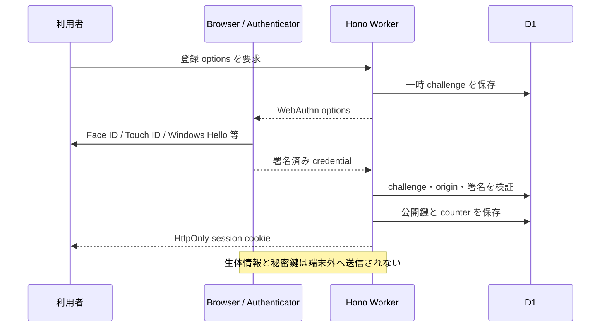

# 認証、プライバシー、安全境界

## パスキー認証

ログインはパスキーだけです。メールアドレスとパスワードは収集しません。

- D1 に保存するのは、表示名、WebAuthn 公開鍵、署名 counter、端末種別、セッション token のハッシュだけ。
- セッション cookie は `HttpOnly / Secure / SameSite=Lax`、有効期間は30日。
- 新規ユーザーの role は常に `member`。管理 API は画面表示に頼らず、サーバー側で session と `admin` role を再確認する。
- 認証 API は IP と操作種別のハッシュを使って D1 で回数を制限する。

## 利用分析

- 記録するのは、ページ表示、記事を開いた、保存した、一次情報へ移動した、といった最小限の利用イベントだけ。ログイン中なら利用者 ID と結びつくが、IP アドレス、検索語、生体情報、パスキーの内容は保存しない。
- ログインしていない閲覧者のイベントを受ける API も回数を制限し、受信本文は解析前に 4 KiB で打ち切る。

## 守っていること

- 外部記事の本文を転載せず、メタデータ、短い要約、原典 URL だけを扱う。
- IP アドレスと検索語を分析イベントへ保存しない。
- WebAuthn の秘密鍵と生体情報を取得しない。
- session token は平文保存せず SHA-256 hash を保存する。
- 403、CAPTCHA、ログイン壁、利用条件を回避しない。
- Workers AI の失敗時は候補を `pending` にし、推測で公開しない。
- secret、接続情報、ローカル `.env`、Wrangler state を commit しない。
- 情報源の権利と利用条件は各提供元に帰属する。
