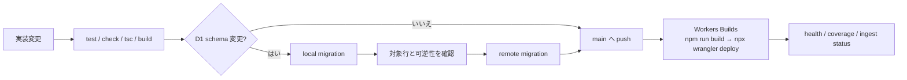

# 構築とデプロイ

## Cloudflare の binding

`wrangler.toml` は次の binding を前提にしています。

| Binding | Resource | 必須 |
|---|---|---|
| `ASSETS` | Astro build output | 必須 |
| `DB` | D1 database | 必須 |
| `CACHE` | KV namespace | 必須 |
| `INGEST_QUEUE` | Queue producer / consumer | 必須 |
| `AI` | Workers AI | 必須 |
| `CF_VERSION_METADATA` | Worker のバージョン情報（`/api/health`） | 必須（設定のみ） |
| `HYPERDRIVE` | PostgreSQL archive | 現在の本番で使用 |
| `ARCHIVE` | R2 bucket | 任意、現在は未設定 |

## 新しい環境を作る

1. D1 database を作成し、`DB` binding を設定する。
2. KV namespace を作成し、`CACHE` binding を設定する。
3. Queue `fde-radar-ingest` を作成し、producer / consumer を設定する。
4. Workers AI の `AI` binding を設定する。
5. PostgreSQL を使う場合は `migrations/postgres/0001_archive.sql` を実行し、Hyperdrive を設定する。
6. R2 fallback を使う場合だけ bucket を作り、`ARCHIVE` binding を有効にする。
7. 下の secret を設定する。
8. D1 migration を適用し、deploy する。

```bash
npx wrangler secret put INGEST_TOKEN
npx wrangler secret put EMAIL_TEST_TOKEN
npx wrangler secret put RESEND_API_KEY
npx wrangler secret put RESEND_TO
npx wrangler secret put RESEND_FROM
npm run db:migrate:remote
npm run cf:deploy
```

## Secret

| Secret | 用途 |
|---|---|
| `INGEST_TOKEN` | 手動収集・backfill・`/api/ingest/status` の token 認証。未設定なら token 認証は常に拒否される |
| `EMAIL_TEST_TOKEN` | `POST /api/ingest/email/test`（接続テストと日報の試験送信）専用 |
| `RESEND_API_KEY` | Resend でのメール送信 |
| `RESEND_TO` | 通知先メールアドレス |
| `RESEND_FROM` | Resend で認証したドメインの送信者（例: `FDE Radar <alerts@example.com>`）。未設定なら sandbox 送信者 `onboarding@resend.dev` を使い、Resend アカウント本人のアドレスにしか届かない |

接続文字列、PostgreSQL のパスワード、API token、メールアドレス、各種 secret は Git に保存しません。

## デプロイの流れ



`main` への push は Cloudflare Workers Builds（`kekincai/fde` の `main` に接続済み）が自動でビルドし、`npx wrangler deploy` で本番へ出します。GitHub Actions は使いません。手元から直接出す場合は `npm run cf:deploy` も使えます。

リリース前に最低限次を確認します。

```bash
npm test
npm run check
npx tsc --noEmit
npm run build
npm run db:migrate:local
npm run db:migrate:remote
git push origin main   # Workers Builds が deploy する
```

## D1 migration の順序

D1 migration は自動では実行されません。適用のタイミングは migration の種類で逆になります。

| migration の種類 | いつ適用するか | 理由 |
|---|---|---|
| 列やテーブルを**追加**する | push の**前** | 新しいコードがそれを読むため |
| 列やテーブルを**削除**する | 新しいコードを deploy した**後** | 古いコードがまだ書いているため |

`0025_drop_unread_schema.sql` は後者です。

適用済みの migration は再実行されないので、schema 変更がないリリースで `db:migrate:remote` を実行しても害はありません。ただし本番 migration は、SQL と対象行を確認してから実行してください。

## デプロイ後の確認

```bash
curl -fsS https://fde.kejincai.dev/api/health
curl -fsS https://fde.kejincai.dev/api/coverage
curl -fsS -H "Authorization: Bearer $INGEST_TOKEN" https://fde.kejincai.dev/api/ingest/status
```

`/api/health` の `version` と `deployedAt` で、いま動いている Worker のバージョンが分かります。
