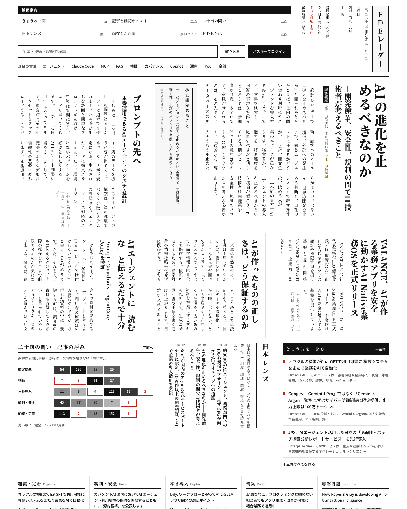
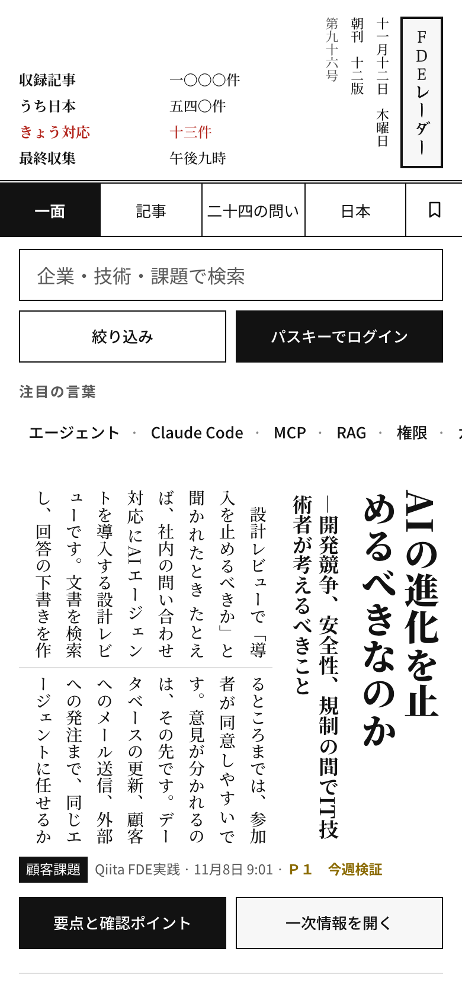

# 画面とアイコンの設計

画面は日本の新聞のブランケット判を手本にしています。各面が何を載せるかは [overview.md](overview.md#各面の読み方) を参照してください。この文書は、画面を変更する人のための約束事です。

## 紙面の基本

- スタイルは `src/styles/app.css` の1ファイル。先頭の `:root` に色・書体・余白のトークンを置く。
- 白い紙、墨色の本文、灰色の罫。色は朱（P0 と薄い章）だけ。
- ダークモードはない（`color-scheme: light`）。ダークモードの端末でも最初の1フレームから白い紙面を描く。
- 書体: 本文は Noto Serif JP、操作とラベルは Noto Sans JP、題字「ＦＤＥレーダー」だけ Yuji Syuku（6字にサブセット）。
- Web フォント（Google Fonts）は最初の表示を止めない。届くまでは端末の明朝・ゴシックで表示する。
- 縦組みに対応するブラウザーでは、一面の見出しと本文を縦組みにする。
- 報頭の朝刊 / 夕刊と版は最後に成功した収集の時刻から決まる。静的ビルドには日付を書き込まない。

## 状態と操作

- 表示中の面と絞り込みは URL に反映する（`useRadarState`）。共有・ブラウザーの戻るに対応し、面が変わるとページタイトルとフォーカスも移る。
- キーボード操作（`j` / `k` / `o` / `s` / `/` / `Esc`）の一覧は [overview.md](overview.md#キーボード操作)。
- 自動生成された確認ポイント・関連箇所は、タイトルや概要の繰り返しなら表示しない。
- 動きを減らす設定では、アニメーションとスクロール演出を停止する。

## レスポンシブ

| 幅 | 紙面 |
|---|---|
| 768px 未満 | 1段組のモバイル紙面 |
| 768–1099px | 段を減らした紙面 |
| 1100px 以上 | 全段 |

スマートフォン（タッチ操作）では:

- 押せる要素は 44 × 44 px 以上。
- 入力欄は 16px（iOS Safari が入力時に拡大しないため）。
- hover の色はマウス操作の端末だけ。
- `viewport-fit=cover` に合わせて、ノッチ・ホームインジケーター・Safari の浮いたツールバーの下に本文が隠れないよう safe area 分の余白を取る。

## 印刷

「この面を印刷」はブランケット判1枚（406 × 545 mm）に収まるよう縮小し、PDF 名に号数と面を入れます。

## アイコン

UI アイコン（管理画面のみ）は MIT ライセンスの [Tabler Icons](https://tabler.io/icons) に統一しています。React では `@tabler/icons-react` を利用し、`src/components/radar/Icon.tsx` の明示的な対応表から必要なアイコンだけを読み込みます。名前空間全体の動的 import は行わないため、アイコン数を増やしても未使用の数千アイコンを本番 bundle に含めません。

- 基準グリッド: 24 × 24
- 標準 stroke: 1.8
- 本文・操作: 14–20px
- セクション見出し: 25–32px
- 装飾アイコンは `aria-hidden`、アイコンだけの操作はボタン側に `aria-label` を付与

サイトのマーク（favicon やホーム画面のアイコン）は [design/brand/README.md](../design/brand/README.md) を参照してください。

## 変更したら確認すること

一面・二面・三面・社説・アカウント・管理画面を、次の条件で確認します。

- 幅 390px、900px、1440px
- 印刷プレビュー
- iPhone の Safari（縦・横、ライト・ダーク）

## スクリーンショットの更新

`docs/screenshots/` の画像は公開サイトから撮ったものです（2026-11-11 撮影）。画面を大きく変えたら撮り直してください。デスクトップは幅 1440px、スマートフォンは幅 390px・2倍解像度で撮っています。

| ファイル | URL |
|---|---|
| `front.png` | `/` |
| `story.png` | `/?a=<記事ID>` |
| `map.png` | `/?v=map` |
| `about.png` | `/?v=about` |
| `mobile.png` | `/`（幅 390px） |
