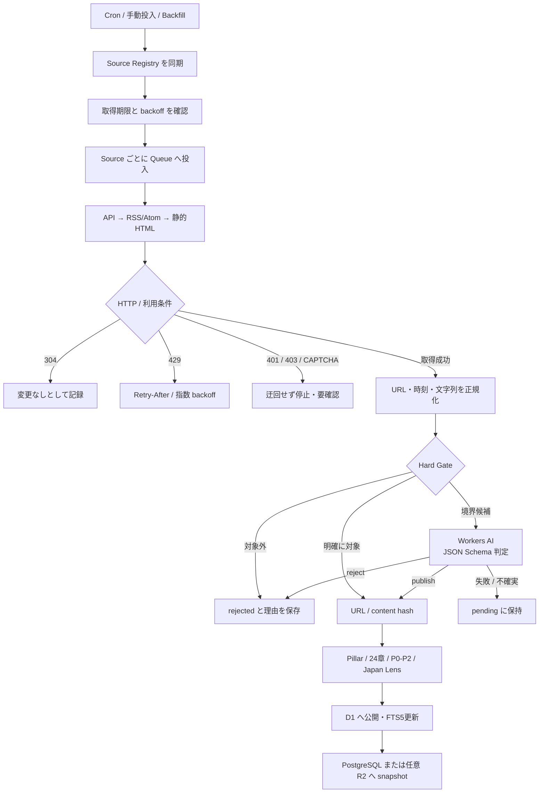
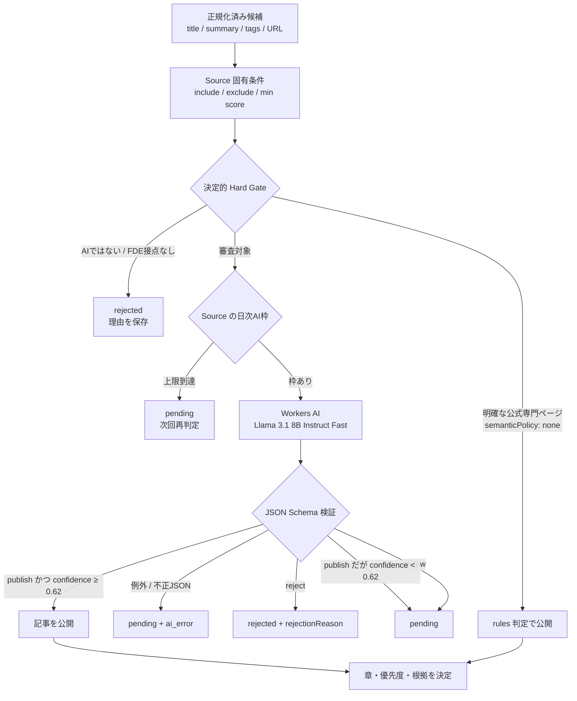
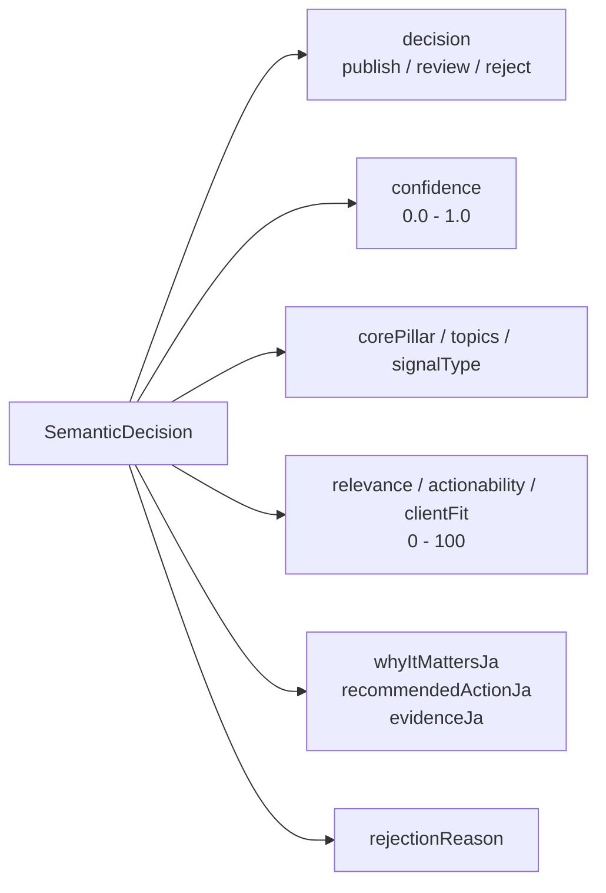

# 収集と公開判定

FDE Radar は AI ニュースの量を増やすサイトではありません。顧客の現場を理解し、小さく試し、本番で確かめ、運用可能な型として残すための行動材料を集めます。この文書は「何を集め、何を載せないか」と、その判定の仕組みをまとめます。

日々の運用手順（手動収集、backfill、情報源の追加）は [operations.md](operations.md) を参照してください。

## 収集ストリーム

| ストリーム | 主な問い | 代表ソース |
|---|---|---|
| official-change | API・製品・廃止予定に何が変わったか | OpenAI、Anthropic、Google、AWS、Microsoft、Cloudflare |
| customer-outcome | 顧客課題、導入条件、成果は何か | 公式 Customer Stories、国内事例 |
| production-pattern | 本番化・統合・運用の再利用可能な型は何か | Palantir、各社技術ブログ |
| japan-government | 日本の行政利用・安全・制度に何が起きたか | デジタル庁 Gennai、IPA、経産省 |
| japan-enterprise | 日本企業の現場で何が成立したか | 企業技術ブログ、専門メディア |
| field-note | 実装者が得た具体的な知見は何か | Qiita、Zenn、登壇資料 |
| research | 現場課題を解く研究上の進展は何か | 絞り込んだ arXiv |
| report | 市場・経営・組織の大きな変化は何か | AI Index、調査レポート |
| talent | FDE の責任範囲と必要能力はどう変わるか | 公式採用ページ |
| video | デモ・講演から何を確認できるか | 公式 YouTube |

情報源の一覧と設定は `worker/sourceRegistry.ts` を正とします。日本とグローバルは表示時に別軸で集計し、目標比率をおおむね 50:50 とします。

## 収録条件

AI という語があるだけでは収録しません。少なくとも次の一つに具体的な接点が必要です。

- 顧客課題、業務プロセス、導入成果、ROI
- Agent、RAG、Connector、MCP、Legacy 刷新を現場で成立させる具体策
- 統合、本番化、移行、閉域、データ境界、認証、権限、監視、費用
- 評価、プライバシー、セキュリティ、規制、信頼性、ガバナンス
- FDE / FDSE / Deployment Strategist の責任、AI CoE、組織定着、AI-native な働き方

モデル性能だけの記事、一般的な AI ニュース、AI と無関係な官公庁公告、入門チュートリアル、対象外求人は除外します。公開日時が公開ベースライン（2026-06-01 JST）より前の記事は、定期収集でも `rejected` として記録し公開しません。

## パイプライン全体

1. **DISCOVER**: 公式 RSS/API/対象ページから候補を取得する。1 Source = 1 Queue message なので、1つの失敗が他へ波及しない。
2. **EXTRACT**: タイトル、短い概要、公開時刻、タグ、URL を取り出す。
3. **NORMALIZE**: URL、時刻、文字列を正規化する。
4. **HARD GATE**: AI と無関係な情報、一般ニュース、対象外求人、現場との接点がない研究を決定的なルールで除外する。
5. **SEMANTIC REVIEW**: ルールだけでは決めにくい候補を Workers AI が審査する（次節）。
6. **DEDUPE**: 正規化 URL と内容ハッシュ（タイトル・概要・タグ）で同一記事を判定する。同じ事象を別 URL で報じた記事を束ねる仕組みはまだない。
7. **CLASSIFY / PUBLISH**: 工程、章、優先度、Japan Lens を決め、理由・推奨行動・根拠とともに公開する。

すべての候補は `ingest_candidates` に残り、収録・拒否の理由を後から監査できます。

## Workers AI による編集審査

Workers AI は記事を大量生成するためではなく、ルールだけでは FDE との意味的な関係を判断しにくい候補を審査するために使います。取得した外部記事を無条件でモデルへ渡すことはありません。

### モデル設定

| 項目 | 現在の設定 |
|---|---|
| Binding | Cloudflare Workers AI `AI` |
| Model | `@cf/meta/llama-3.1-8b-instruct-fast` |
| Temperature | `0` |
| 最大出力 | `600` tokens |
| 入力 | Source名、収集 stream、タイトル、最大3,500文字の概要、タグ、原典URL |
| 出力 | JSON Schema に一致する構造化データのみ |
| 公開条件 | `decision = publish` かつ `confidence >= 0.62` |

モデルへ全文ページやユーザー情報は送りません。

この処理は「記事全文の自動要約」と同じではありません。AI 審査対象では公開可否と FDE 上の意味、次の行動、根拠を生成しますが、`semanticPolicy: none` の公式専門ページは Source の公開要約と決定的ルールを使います。原文にない顧客成果や数値を補完することはしません。

### AI が返す項目

`whyItMattersJa`、`recommendedActionJa`、`evidenceJa` は日本語で短く返すよう要求し、記事に存在しない事実を作らないことを system prompt で制約しています。文字列長とスコア範囲は Worker 側でも正規化します。

### Source ごとの審査方針

| `semanticPolicy` | 動作 | 用途 |
|---|---|---|
| `required`（既定） | Hard Gate を通った候補を Workers AI で審査 | ニュース、一覧ページ、コミュニティ、研究など |
| `none` | Workers AI を呼ばず、Hard Gate と固定分類で処理 | 内容が限定された公式ガイド、価格、制度、専門ページ |

`none` は「無審査」ではありません。Source の利用範囲、Hard Gate、最低 score、重複排除、固定章、公開 baseline を通過する必要があります。

### 費用と過負荷の制御

各 Source は `dailyItemCap`（既定20、JST の1日単位）を持ち、その日の `semantic_reviewed_count` を差し引いて Workers AI の残り枠を計算します。上限はストリーム単位ではなく Source ごとです。

- 枠を超えた候補は捨てずに `pending` へ残し、次回に審査します。
- AI が `review`（または確度不足の `publish`）と判定した `pending` は、内容が変わらない限り再審査しません。
- 強制的に再審査する場合は、migration で対象行の `semantic_decision` を `'pending'` に戻します。
- AI 判定が失敗した候補は公開せず `pending` に残し、クローラー全体は失敗させません。

これにより、一覧ページの大量更新や parser の異常が Workers AI の quota を一度に消費することを防ぎます。

### 監査

AI の判断は次の場所へ保存します。

- `ingest_candidates`: Hard Gate、AI decision、confidence、model、除外理由、解析時刻
- `articles`: 公開時の semantic decision、model、判定時刻、理由、推奨アクション、根拠
- `source_quality_daily`: AI審査数、AI除外数、AIエラー数

モデルや prompt を変更するときは、既存の `rejected` を無条件に公開へ戻しません。対象候補だけを再審査し、公開率、誤収録、`pending`、AIエラーの差を確認します。

## 章別カバレッジ

ニュースの件数ではなく、FDE の仕事を最初から最後まで説明できることを供給設計の単位にします。各 Source は `chapter_targets` で担当する章を宣言し、公開記事は判定後に必ず一つの `chapter_id` へ分類します。24章の一覧は [overview.md](overview.md#24の問い) を参照してください。

`GET /api/coverage` は24章を欠落なく返し、公開記事数、供給 Source 数、日本記事数を集計します。章ごとの最低記事数と最低 Source 数を両方満たした場合だけ `healthy`、不足は `thin`、記事または Source がゼロなら `empty` とします。画面のナレッジマップと収集運用はこの状態を共有します。

## 品質指標

`source_quality_daily` で発見数、Hard Gate 除外数、AI審査数、AI除外数、公開数、重複数、AIエラー数を Source 別・JST の日別に記録します。

いま確認できるもの:

- `/api/ingest/status`（admin）: Source ごとの直近7日の上記件数、候補の状態別件数、直近20 run
- `/api/coverage`: 章別の empty / thin / healthy
- 管理画面: 利用者、ページ表示、記事展開率、出典遷移率、収集成功率、Source の連続失敗

まだ計測していない（今後の候補）:

- Precision@20 / Actionable@20（人手ラベルが必要）
- Japan Recall、公式一次情報比率、重複イベント率
- 発見までの時間、未分類トピック率、単一 Source 依存
