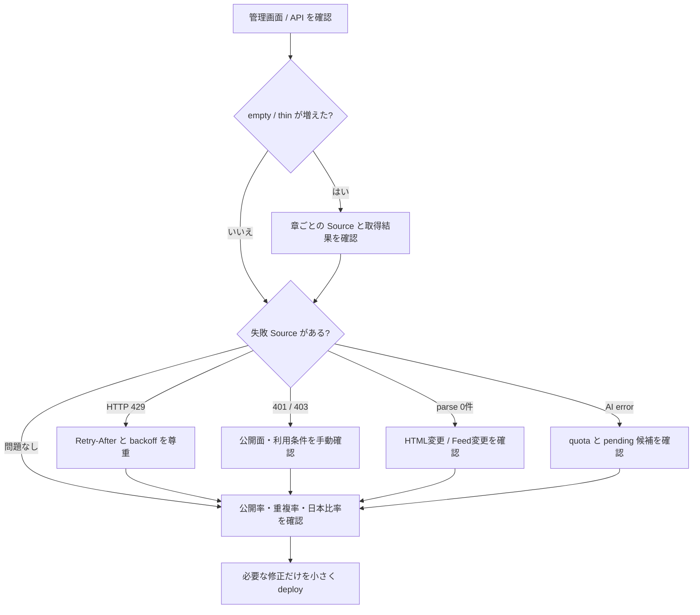

# 運用

収集の定期実行と手動操作、日々の点検、メール通知、障害対応をまとめます。何を収集し何を除外するかは [ingestion-architecture.md](ingestion-architecture.md) を参照してください。

## 定期実行

Cron は UTC で3本設定しています。

| Cron | 日本時間 | 処理 |
|---|---|---|
| `0 */6 * * *` | 6時間ごと | 期限を迎えた Source を Queue に投入 |
| `*/30 * * * *` | 30分ごと | D1 の Source 健康状態を確認し、継続障害だけをメール通知 |
| `30 9 * * *` | 毎日18:30 | 直近24時間の新着記事と収集健康度の日報をメール送信 |

Queue consumer は `max_batch_size = 1`、`max_retries = 3`、`max_concurrency = 5` です。期限切れの認証 challenge・session・リクエスト制限レコードも定期収集時に削除します。

## 手動で収集する

```bash
curl -X POST \
  -H "Authorization: Bearer $FDE_INGEST_TOKEN" \
  -H "Content-Type: application/json" \
  -d '{"sourceIds":["cloudflare-workers-ai-changelog"]}' \
  https://fde.kejincai.dev/api/ingest/dispatch
```

`sourceIds` を省略すると、有効な Source をすべて Queue へ投入します。手動投入では対象 Source の `ETag` と `Last-Modified` を解除して再確認します。

## 過去分を取り込む（backfill）

```bash
curl -X POST \
  -H "Authorization: Bearer $FDE_INGEST_TOKEN" \
  -H "Content-Type: application/json" \
  -d '{"since":"2026-06-01","sourceIds":["qiita-fde"],"pages":[1,2]}' \
  https://fde.kejincai.dev/api/ingest/backfill
```

backfill は Source とページごとに message を分割します。URL の一意制約と content hash により何度でも再実行できます。ただし取得範囲は、各 Source が RSS、API、公開ページで提供している期間までです。短い RSS window を「全履歴」とは扱いません。

## Source を追加・変更する

1. `worker/sourceRegistry.ts` に Source を追加する。
2. RSS / API / HTML の公開面、robots.txt、利用条件、取得頻度を確認する。
3. `kind`、`contentType`、`stream`、`semanticPolicy`、`dailyItemCap` を設定する。
4. 担当する `chapters` を明示する。単一の公式専門ページは必要に応じて `fixedChapter` を使う。
5. `includeTerms` / `excludeTerms` と `minScore` で Source 固有の範囲を狭める。
6. テストを実行し、24章の最低 Source 数を壊していないことを確認する。
7. まず1 Sourceだけ手動投入し、`fetch_runs`、`ingest_candidates`、`source_quality_daily` を確認する。

アクセス制限を迂回する実装は追加しません。403、CAPTCHA、ログイン壁がある Source は停止するか、公式 RSS / API へ切り替えます。

## 管理者を追加する

ユーザーを管理者にする前に、対象 ID と表示名を確認します。

```bash
npx wrangler d1 execute DB --remote \
  --command "SELECT id, display_name, role, created_at FROM users ORDER BY created_at DESC"
```

確認した ID だけを更新します。

```bash
npx wrangler d1 execute DB --remote \
  --command "UPDATE users SET role='admin', updated_at=CURRENT_TIMESTAMP WHERE id='<USER_ID>'"
```

管理者 tab は admin だけに表示され、管理 API もサーバー側で role を検証します。

## 日々の点検



### 毎日

- `/api/health`: Worker と基本 binding の応答
- `/api/ingest/status`: Source の最終成功、失敗、backoff、直近 run（admin session または `INGEST_TOKEN`）
- `/api/coverage`: 24章の `healthy / thin / empty`
- 管理画面: page view、記事 open、保存、Source 品質

### 毎週

- Source 別の発見数、Hard Gate 除外、AI審査、公開、重複、AIエラー
- 日本 / Global の比率と、日本の一次情報不足
- 章ごとの単一 Source 依存
- P0 の誤判定、`pending` の滞留、古い記事の公開状態
- 保存・Source click が多い章と、記事があるだけで読まれていない章

### 定期的に

- npm dependency と Wrangler の更新
- D1 migration と PostgreSQL schema の整合確認
- Passkey session / challenge の期限切れ確認（Cron でも削除）
- Source の利用条件、RSS、API、robots.txt の再確認
- Source Registry の無効 Source と恒常的な0件 Source の整理

## メール通知

Cloudflare Free では Log Explorer の Scheduled Query と Email Sending が有料のため、FDE Radar は D1 を直接監視し、Resend Free から管理者へ送信します。送信設定は [deployment.md](deployment.md#secret) を参照してください。

| メール | 条件 | 重複制御 |
|---|---|---|
| 収集異常 | 24時間以上の長期 backoff、`consecutive_failures >= 3`、または最終成功が期待周期の3倍（最低24時間）を超過 | Source ごとに6時間の cooldown |
| 日報 | 毎日18:30 JST | JST の日付ごとに1回 |

収集異常はログの発生ではなく最終的な Source 状態で判定するため、一時的な失敗が後続の retry で回復した場合は通知しません。

- `consecutive_failures` は収集 run ごとに1つ進み、Queue の retry（最大3回）は数えない。
- retry 中の失敗は記録せず、最後の配信で失敗したときだけ `fetch_runs` に error を1件書く。
- 403 は3回連続の run（通常約18時間）で7日間の手動確認 backoff に入る。

日報は直近24時間（前回の日報以降）に初回収集された記事を P0 → P1 → P2、priority score、公開時刻の順で最大30件掲載し、記事要約、次の一手、取得成功率、正常 / 異常 Source 数を含めます。新着が0件でも収集健康度を送信します。外部由来のタイトル、URL、要約は HTML escape してからメールへ埋め込みます。

Workers Logs の構造化 event `ingest_source_manual_review`、`ingest_batch_retry`、`ingest_archive_failed` は調査用として引き続き出力します。

## 障害対応

| 症状 | 最初に確認 | 対応 |
|---|---|---|
| サイト全体が開かない | Cloudflare deployment、`/api/health` | 直近 deploy と Static Assets binding を確認 |
| 画面は開くが記事がない | `/api/articles`、D1、記事 `status` | migration、公開ベースライン、filter 条件を確認 |
| 特定 Source が止まった | `sources` と `fetch_runs` | HTTP status、backoff、Feed URL、HTML変更を確認 |
| `304` が続き再判定できない | ETag / Last-Modified | 保護された手動 dispatch で対象 Source だけ再取得 |
| Queue が再試行する | consumer log、error message | 失敗 Source を分離し、原因を修正して再投入 |
| Workers AI が失敗する | `ai_error_count`、`pending` | quota・schema response を確認。失敗候補を誤公開しない |
| 検索結果が欠ける | `articles_fts` | article 更新時の FTS delete/insert と migration を確認 |
| パスキー登録に失敗 | origin、RP ID、challenge expiry | 実ドメイン、HTTPS、端末時刻、challenge を確認 |
| PostgreSQL archive が失敗 | Hyperdrive、PostgreSQL schema | 接続と `fde.source_archives` を確認。D1公開処理とは分けて調査 |

障害時に Source 全件を無条件に再取得しないでください。対象 Source と原因を先に絞り、API 制限と相手サイトへの負荷を守ります。

## 既知の制約

- HTML が JavaScript 描画のみの Source は0件になることがある。可能なら公式 RSS / API を優先する。
- 公式 Feed が直近記事しか提供しない場合、それ以前を完全に backfill できない。
- Workers AI の日次上限を守るため、Source ごとに `dailyItemCap` を持つ。
- 日本語要約は Source の公開情報と自動抽出を使い、過去記事を人手で一件ずつ再要約しない。
- 同じ出来事を別 URL で報じた記事を1本に束ねる仕組みはまだない。
- R2 fallback はコード上対応しているが、現在の本番 binding では有効化していない。
