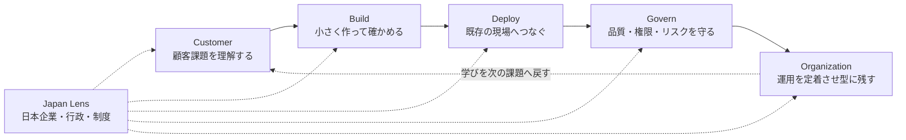

# サイトの考え方と読み方

FDE Radar が何を扱い、記事をどう並べ、各面をどう読めばよいかをまとめます。収集と判定の内部の仕組みは [ingestion-architecture.md](ingestion-architecture.md) を参照してください。

## 5つの工程

記事は「AI を顧客の現場で成果にする」までの実務ループに沿って整理します。

`Japan` は6番目の工程ではなく、すべての工程を横断する視点（Japan Lens）です。

## 24の問い

5つの工程をさらに24の章（問い）に分けます。公開される記事は必ずどれか1つの章に入ります。

| 工程 | 章 |
|---|---|
| Customer（顧客課題） | 顧客課題、ユースケース、業務プロセス、成果・ROI |
| Build（構築） | Agent、RAG・検索、連携・Connector、Legacy刷新 |
| Deploy（本番導入） | Cloud・本番化、On-prem・閉域、Data、Identity・権限、Observability、Cost |
| Govern（統制・安全） | Security、Evaluation、Privacy、Regulation、Reliability |
| Organization（組織定着） | FDEの役割、AI CoE、Change Management、人材・採用、AI-native組織 |

各章には「最低これだけの記事数と情報源数が欲しい」という目標があり、満たしていれば `healthy`、足りなければ `thin`、ゼロなら `empty` です。画面では `healthy` 以外をまとめて「薄い章」として朱の枠で示します。薄い章は話題が少ないのではなく、一次情報がまだ十分に集まっていない章です。

## 優先度

| 優先度 | 意味 | 代表例 |
|---|---|---|
| P0 | きょう対応 | 直近14日以内の明確な脆弱性、侵害、破壊的変更、提供終了 |
| P1 | 今週検証 | 本番化、認証、監視、連携、費用などの実装・運用候補 |
| P2 | 背景学習 | 論文、調査、採用、組織、長期的な判断材料 |

本文に「セキュリティ」「期限」と書かれているだけでは P0 にしません。

## 記事の種類

| 種類 | 内容 |
|---|---|
| 実務（既定） | 導入事例、公式の変更、本番化の型、制度など、現場で使う情報 |
| リサーチ | 論文や調査レポート |
| 求人 | FDE や関連職の公式採用情報 |
| 保存 | ログインして保存した記事（要ログイン） |

研究と求人は既定の一覧には出さず、それぞれの種類を選んで読みます。日本とグローバルはおおむね半々になるよう集めています。

## 各面の読み方

画面は日本の新聞に見立てています。

| 面 | 内容 |
|---|---|
| 一面 | 題字と号数、収録記事数と最終収集時刻、トップ記事と二段目、きょう対応（P0）、日本レンズ、24の問いの表、工程ごとの短信 |
| 二面 | 1本の記事。要点、現場での確認ポイント、一次情報への導線、同じ問いの他の記事 |
| 三面 | 24の問い（ナレッジマップ）。章ごとの記事数と情報源数、薄い章 |
| 社説 | ＦＤＥとは。サイトの立場、収集の仕組み、優先度の読み方 |

- 本文は保存していません。続きは必ず一次情報（原典）で読みます。
- 要約と確認ポイントは自動生成です。判断の前に一次情報で確認してください。
- 報頭の朝刊 / 夕刊と版は、最後に収集が成功した時刻で決まります。
- 表示中の面と絞り込みは URL に反映されるので、そのまま共有でき、ブラウザーの戻るも使えます。
- 「この面を印刷」で、ブランケット判1枚に収まる PDF を作れます。

## キーボード操作

| キー | 動作 |
|---|---|
| `j` / `k` | 見出しを紙面の順に移動 |
| `o` | 一次情報を開く |
| `s` | 記事を保存 |
| `/` | 検索欄へ移動 |
| `Esc` | 閉じる（アカウント画面が開いているときは画面だけ閉じる） |
